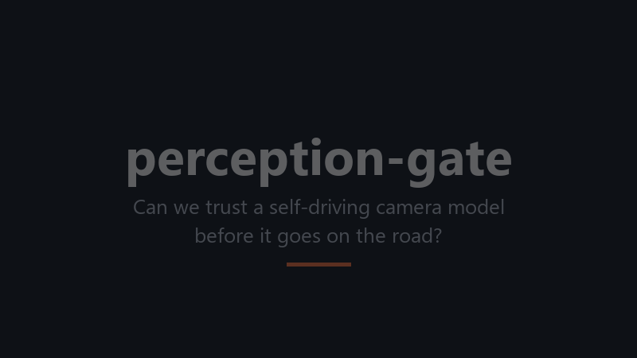
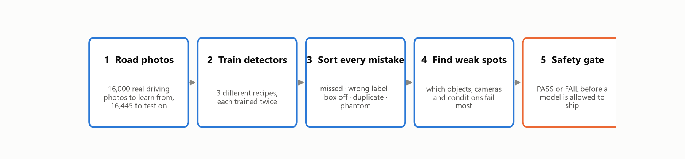
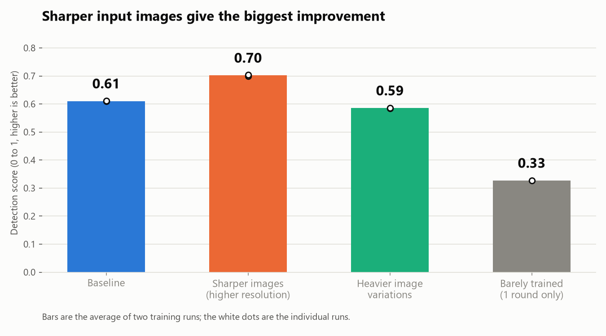
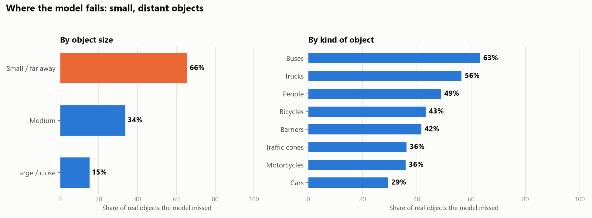
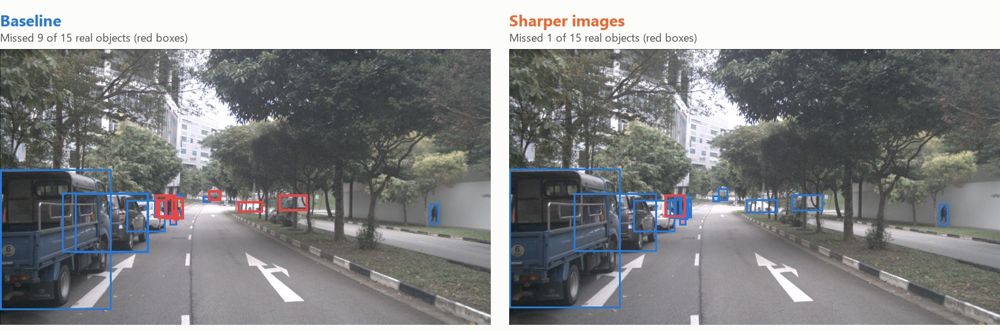
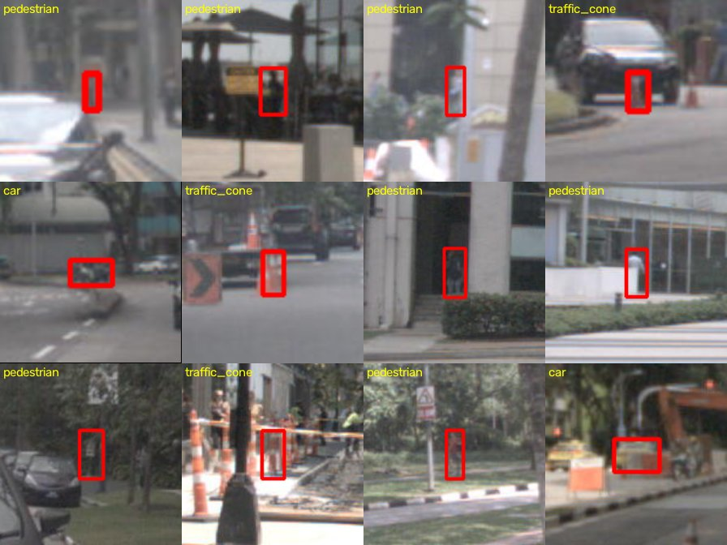
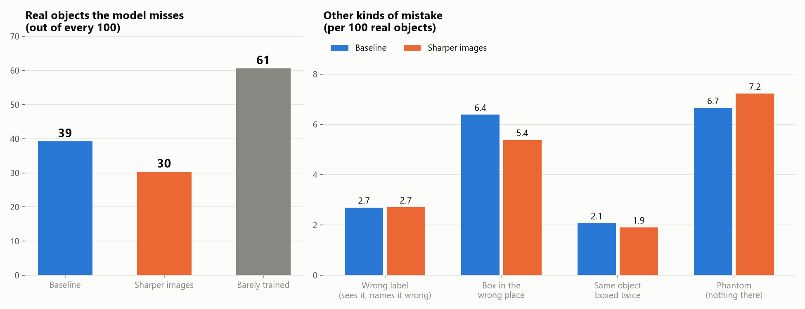
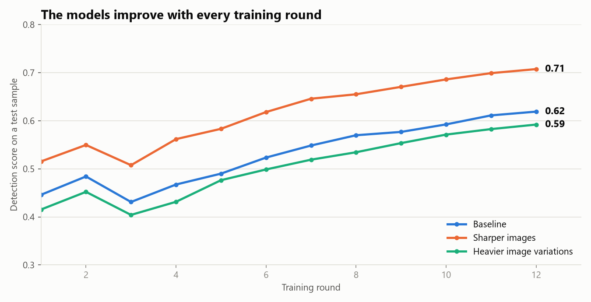
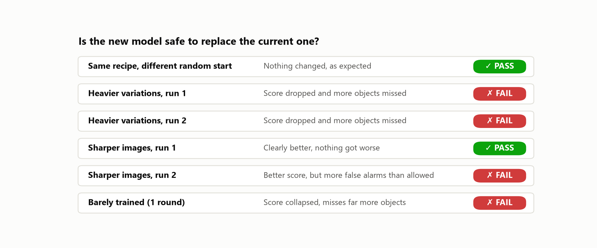

<h1 align="center">perception-gate</h1>
<p align="center"><b>Can we trust a self-driving camera model before it goes on the road?</b></p>

<p align="center">
  
</p>

## What is this project?

A self-driving or driver-assist car has a camera "brain" that spots cars, people, bicycles and traffic cones.
Engineers keep building new versions of that brain. Before a new version replaces the old one, someone has to check
that it is really better and has not become worse in some situation.

This project does that check automatically. It trains several camera models on thousands of real driving photos,
finds **exactly where and how each model goes wrong**, and ends with a **safety gate** that says **PASS** or **FAIL**.

<p align="center"></p>

## What we found

### 1. Sharper input images give the biggest improvement

We trained three versions of the model. Giving the model sharper photos raised its detection score from **0.6105** to
**0.7022** (1.0 would be perfect). Heavier random image changes during training made it slightly worse.

<p align="center"></p>

### 2. The weak spot is small, faraway objects

Out of **39,445** small objects in the test photos, the baseline model missed **25,913** of them (**65.7%**), while it
missed **39.2%** of all objects. Large, close objects are rarely missed.

<p align="center"></p>

Here is the same road scene seen by the baseline model and by the sharper-image model. Blue boxes are what the model found;
red boxes are real objects it missed.

<p align="center"></p>

And a few real examples of small objects the baseline missed (red boxes):

<p align="center"></p>

### 3. Every mistake is sorted into a type

Instead of one overall score, every error is labelled: **missed** the object, **wrong label**, **box in the wrong place**,
**boxed twice**, or a **phantom** detection where nothing exists. That tells engineers what to fix first.

<p align="center"></p>

### 4. The models improve steadily as they train

<p align="center"></p>

## The safety gate

The gate compares a new model with the current one and answers one question: **is it safe to replace it?**
A model passes only if:

- its overall score does not drop,
- no situation (a camera, a type of object, an object size, a place) gets noticeably worse, and
- no kind of mistake becomes noticeably more common.

To avoid reacting to luck, the gate re-checks every comparison 200 times on resampled test photos.
It correctly rejected a model that was deliberately under-trained (its score fell by **0.2075**) and accepted
a model that was simply retrained with a different random start.

<p align="center"></p>

## A fast checker written in C++

Matching the model's guesses to the real objects is the heart of the analysis. It is written twice: in Python
and in C++. On all **131,676** objects in the **16,445** test photos the two give exactly the same answers, and the C++
version runs about **65 times faster**.

## Try it yourself

<details>
<summary>Setup and commands (for engineers)</summary>

Requirements: Python 3.12, a CUDA GPU, a C++17 compiler. Tested on Windows 11 with an RTX 5090.

```powershell
python -m venv .venv
.\.venv\Scripts\python.exe -m pip install torch==2.11.0 torchvision==0.26.0 --index-url https://download.pytorch.org/whl/cu128
.\.venv\Scripts\python.exe -m pip install -r requirements.txt
```

Download nuImages v1.0 "All" **Metadata** and **Samples** from nuscenes.org and extract them to
`nuimages-v1.0-all-metadata/` and `nuimages-v1.0-all-samples/` in the repo root.

Build the C++ checker:

```
g++ -O2 -std=c++17 -static cpp/taxonomy.cpp -o cpp/build/taxonomy.exe
```

Main steps (see `run_all.sh` for the full order):

```
python src/prep_data.py          # build the dataset and slice definitions
python src/train.py baseline 0   # train one model (configs: baseline, strong_aug, hires, degraded)
python src/predict.py baseline_s0
python src/evaluate.py baseline_s0 --crosscheck
python src/run_taxonomy.py baseline_s0
python src/triage.py baseline_s0
python gate.py --baseline baseline_s0 --candidate hires_s0
python src/make_visuals.py       # rebuild the charts and the overview animation
python verify_claims.py          # re-check the numbers quoted in this README
```

</details>

## What is in this repository

| Path | What it is |
|---|---|
| `src/` | data preparation, training, evaluation, mistake sorting, triage and chart code |
| `cpp/taxonomy.cpp` | the C++ checker |
| `gate.py`, `gate_config.yaml` | the safety gate and its settings |
| `results/` | every number behind the charts (scores, mistake counts, gate decisions) |
| `figures/` | the charts, example photos and the overview animation |
| `report.md` | the whole story in plain language |
| `verify_claims.py` | checks that the numbers in the documents match the results files |

<sub>Data: nuImages from nuScenes (Motional). Models: YOLO11.</sub>
